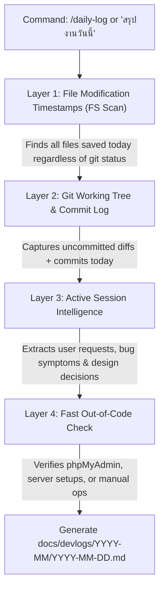

# 📝 Universal Daily Devlog & Session Changelog Recorder

An autonomous engineering recorder for capturing, analyzing, and documenting daily software modifications, bug fixes, refactoring, and architectural decisions into high-density, standardized Markdown devlogs across **any repository, framework, or technology stack**.

---

## 🎯 Core Directives

1. **Reality-First Detection (Never Rely Solely on Git)**:
   In real development, Git commits may be infrequent, staged hours apart, or non-existent for the day. This skill uses a **Multi-Layer Detection Engine** that starts with physical file system modification timestamps (`LastWriteTime >= Today 00:00:00`), combines Git working tree diffs and commits, and synthesizes active conversation context.
2. **High-Density Institutional Standard**:
   Devlogs are not merely loose notes or commit dumps; they are formal engineering artifacts formatted according to the *Keep a Changelog* standard (Added, Changed, Fixed, Removed, Security, Database) with clear rationales, impact matrices, and tomorrow's priorities.
3. **Living Continuity & Fast Resumption**:
   Daily devlogs are partitioned by month in `docs/devlogs/YYYY-MM/YYYY-MM-DD.md`. Each run updates the monthly index and mirrors key decisions back to `PROJECT_SUMMARY.md`, allowing any future agent or human to instantly restore context.

---

## 🔍 Multi-Layer Change Detection Architecture

When triggered, execute the 4-layer discovery process:



---

## 🚀 Execution Workflow

### Step 1: Run Automated Change Detection

Run the bundled detection script from the skill directory, or fall back to native commands:

```bash
# Preferred: Run bundled Python detection script
python <skill-path>/scripts/detect_daily_changes.py --repo . --json
```

*Or via PowerShell fallback:*
```powershell
# Scan files touched today (excluding vendors, git, and caches)
Get-ChildItem -Recurse -File | Where-Object { 
    $_.LastWriteTime -ge (Get-Date).Date -and 
    $_.FullName -notmatch '\\(\.git|vendor|node_modules|backups|\.cache|tmp|scratch)\\' 
} | Select-Object LastWriteTime, Length, FullName
```

Also check Git status and today's commits:
```bash
git status --short
git log --since="today 00:00:00" --oneline
```

### Step 2: Extract Session Intent & Architectural Rationale

Review the active conversation transcript and recent tool history:
- What did the user initially request or complain about?
- What was the root cause of any bugs investigated?
- What architectural decisions or design patterns were chosen (and *why*)?
- What institutional naming conventions or domain constraints were preserved?

### Step 3: Fast Out-of-Code Verification Prompt

If there are indications of work done outside local code (e.g. database schema changes executed directly in phpMyAdmin, cloud server / aaPanel configs, third-party webhook setups, or manual API tests), ask the user **one single concise question**:

> *"ระบบตรวจพบการปรับปรุงโค้ด [N] ไฟล์ข้างต้น มีงานนอกโค้ด (เช่น การตั้งค่าบนเซิร์ฟเวอร์, แก้ไขตารางใน phpMyAdmin, หรือการทดสอบภายนอก) ที่ต้องการให้บันทึกเพิ่มเติมในวันนี้ไหมครับ? (หากไม่มี สามารถตอบ 'ไม่มี' หรือให้ดำเนินการต่อได้ทันที)"*

*(If the user explicitly invoked the skill in a closing/wrapping context where no outside work is indicated, you may proceed directly with what is known).*

### Step 4: Synthesize the Daily Devlog

1. Determine target path: `docs/devlogs/YYYY-MM/YYYY-MM-DD.md` (e.g. `docs/devlogs/2026-09/2026-09-29.md`). Ensure directory exists.
2. Structure the file strictly according to `references/template.md`:
   - **Header & Metadata:** Date (Thai formal + ISO), Branch, Commits count, Total files touched.
   - **1. Executive Summary:** 2–3 sentences explaining core objectives and milestones completed.
   - **2. Categorized Changes:**
     - ✨ `Added` (New endpoints, UI pages, tables, modules)
     - 🔄 `Changed / Refactored` (Logic updates, UI polish, performance tuning)
     - 🐛 `Fixed` (Bugs resolved with root cause and fix mechanism)
     - 🗄️ `Database / Schema` (DDL migrations, new tables, indexing)
     - ⚙️ `Out-of-Code Operations` (Server/environment tweaks)
   - **3. Impacted Files Matrix:** Table of files touched with timestamp, category, size, and 1-line note.
   - **4. Architectural Decisions:** Key decisions made with rationale.
   - **5. Known Blockers & Tomorrow's Priorities:** Active watchlist and next immediate steps.

### Step 5: Update Monthly Index & Living Project State

1. **Monthly Index (`docs/devlogs/YYYY-MM/README.md`)**:
   - Check if `docs/devlogs/YYYY-MM/README.md` exists. If not, initialize it.
   - Add/update today's row in the summary table with link `[YYYY-MM-DD](./YYYY-MM-DD.md)`.
2. **Mirror to `PROJECT_SUMMARY.md`**:
   - Ensure the latest milestone is reflected in Section 2 (`Current State & Progress`) of `PROJECT_SUMMARY.md`.

### Step 6: Present Executive Completion Report

Provide the user with a concise, clean summary in Thai:
- Path to the newly created devlog (`docs/devlogs/YYYY-MM/YYYY-MM-DD.md`).
- Bullet points of the day's key milestones.
- Confirmation of total files recorded.

---

## 📋 Quality Bar & Best Practices

- **Zero AI Slop**: Write clear, factual, engineering-grade summaries. Avoid generic praise or filler text.
- **Accurate Timestamps**: Use actual file modification times recorded by the operating system.
- **Institutional Alignment**: Respect project-specific domain terms (e.g., naming invariants in `AGENTS.md` or `CONTEXT.md`).
- **Idempotent Updates**: If `/daily-log` is run multiple times on the same day, update the existing `YYYY-MM-DD.md` gracefully without duplicating content.
